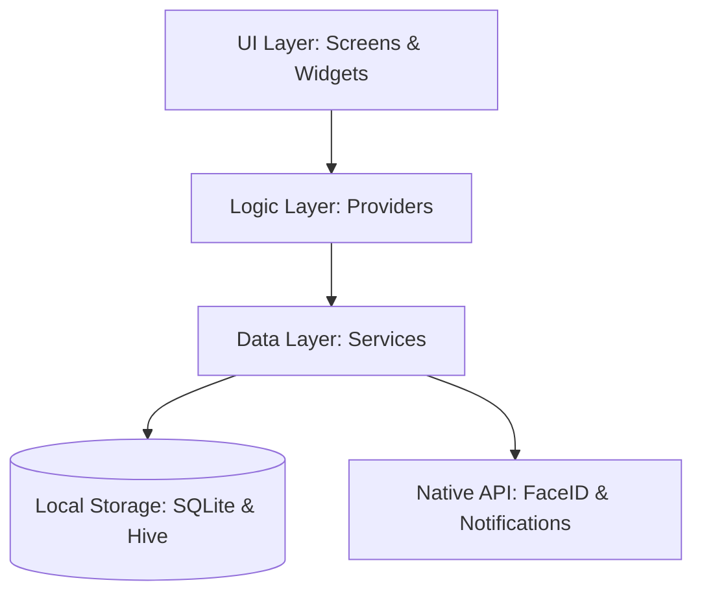
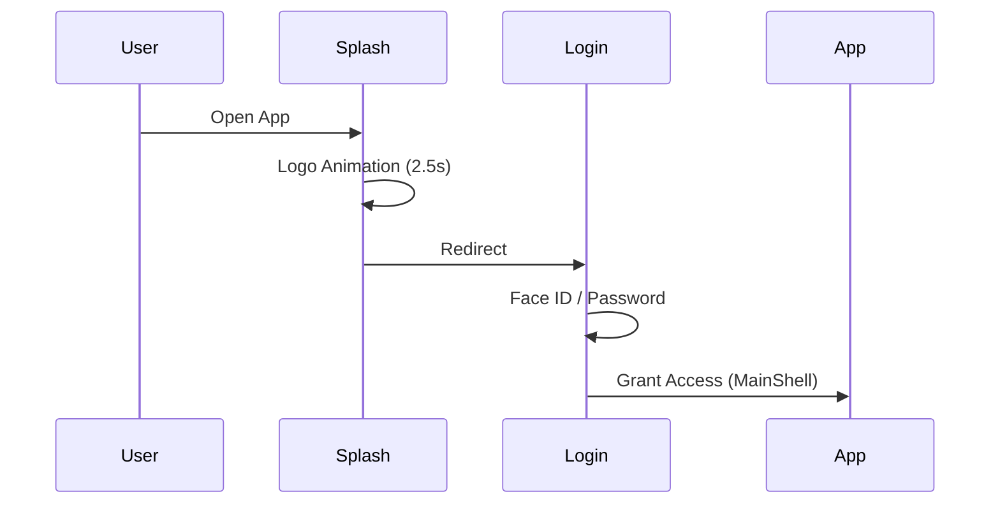

# SpendWise AI Architecture Overview

This document outlines the architectural design and system flow of the **SpendWise AI** application.

## High-Level Architecture

The application follows a **Clean Architecture** pattern, separated into logical layers to ensure scalability, testability, and maintainability.

---

## 1. UI Layer (lib/screens & lib/widgets)
The UI is built with Flutter and organized into modular screens:
- **Splash**: Initial entry with branding animation.
- **Login**: Secure access via Biometrics (Face ID) or Admin credentials.
- **Dashboard**: High-level financial overview with interactive `fl_chart` charts.
- **History**: Detailed list of expenses with filtering capabilities.
- **Add Expense**: Transaction entry point with real-time budget validation.
- **Settings**: Configuration, theme management, and data export.

## 2. State Management (lib/providers)
The app uses the **Provider** package for reactive state management:
- `ExpenseProvider`: Manages the list of expenses, handles CRUD, and communicates with `AnalyticsService`.
- `BudgetProvider`: Manages monthly/daily spending limits.
- `ThemeProvider`: Handles persistence and switching between Light and Dark modes using Hive.

## 3. Services Layer (lib/services)
Encapsulates business logic and external integrations:
- `DatabaseService`: Handles SQLite (`sqflite`) operations for expenses, budgets, and user accounts.
- `AuthService`: Manages authentication state, biometric verification, and password hashing (`crypto`).
- `AnalyticsService`: Processes raw expense data into insights (weekly summaries, category breakdowns).
- `NotificationService`: Manages local push notifications for budget alerts.

## 4. Data Layer & Storage
SpendWise AI uses a dual-database strategy:
- **SQLite (`sqflite`)**: Used for structured relational data like `expenses`, `users`, and `budgets`. Supports the "Export Database" feature.
- **Hive**: Used for lightweight, key-value storage such as user preferences and theme settings.

---

## Authentication & Navigation Flow

The app enforces a secure startup sequence:

## Security Implementation
- **Password Hashing**: Admin passwords are never stored in plain text; they are hashed using `SHA-256`.
- **Master Password**: A hardcoded recovery key (`spendwise_master_2024`) provides a failsafe reset mechanism.
- **Biometrics**: Integrated via `local_auth` to provide a premium, friction-less security experience.

## Theme System
The `AppTheme` class (lib/theme/app_theme.dart) defines a unified design language including:
- **Gradients**: Vibrant primary gradients for cards and backgrounds.
- **Micro-animations**: Leverages `flutter_animate` for a polished feel.
- **Dark Mode**: Fully supported with semantic colors for consistent readability.
